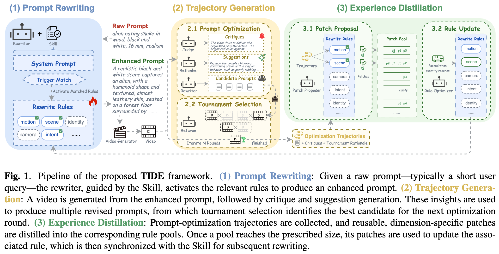
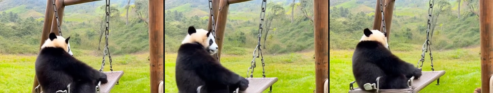
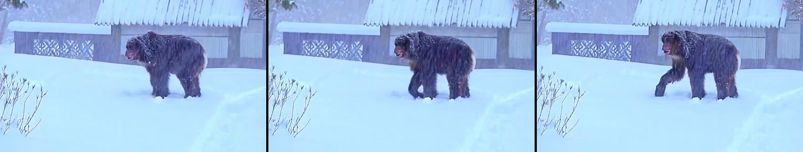
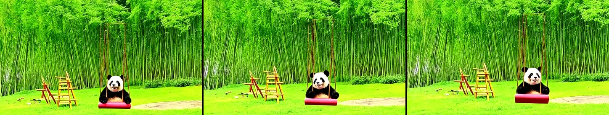
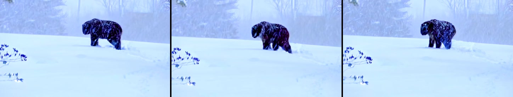
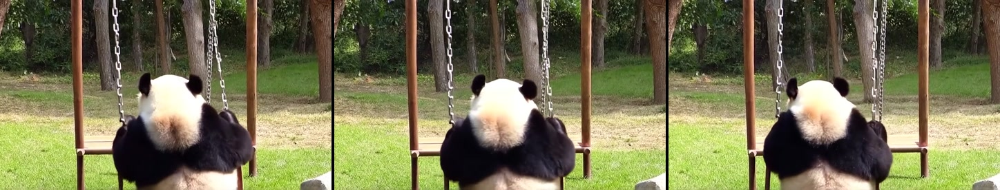
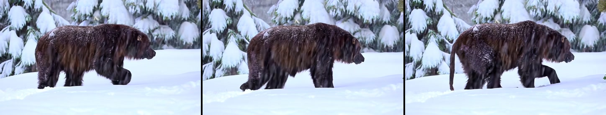

# TIDE: Trajectory-Informed Skill Distillation for Efficient Text-to-Video Prompt Optimization

TIDE distills the experience of *iterative* text-to-video (T2V) prompt
optimization into an interpretable, reusable prompt-rewriting **Skill**. Training
keeps the expensive visual search loop (generate → critique → revise →
tournament); deployment uses source-conditioned rewriting with **one LLM call
followed by one T2V generation** — no test-time visual search and no backbone
fine-tuning.

Evolved from the optimization trajectories of only **100 prompts** on a single
T2V backbone (SANA-Video-2B), TIDE matches computationally expensive
search-based methods and transfers to unseen backbones (CogVideoX1.5-5B,
Wan2.2-TI2V-5B), outperforming prompt-optimization methods designed or fine-tuned
for them.

<p align="center">
  
</p>

> Some entry-point scripts and rule IDs retain the historical `PSISTA` /
> `vista.*` names. They implement the TIDE pipeline described here. The internal
> Python package is `vista/` because TIDE builds on the VISTA visual
> self-improvement loop.

## How it works

Optimization experience is not a single monolithic rewriting policy; it
decomposes into semantic dimensions (motion, camera framing, identity
preservation, scene composition, ...). The Skill is therefore a global system
prompt, source-trigger specifications, and independently updated **rule modules**.

At revision `t`, a rule for dimension `d` is the tuple
`r_d = (τ_d, a_d, ι_d, ν_d, κ_d)`: a source-dependent trigger predicate `τ_d`, a
responsibility axis `a_d`, a rewriting instruction `ι_d`, conditional
negative-prompt artifact terms `ν_d`, and a capability scope `κ_d`.

```text
TRAINING / EXPERIENCE DISTILLATION
raw prompt
    -> Trigger Match + Skill rewrite
    -> enhanced positive/negative prompt
    -> T2V generation
    -> visual critique and revision suggestions
    -> candidate prompts and pairwise tournament selection
    -> prompt-optimization trajectory
    -> Patch Proposer (per activated dimension)
    -> dimension-specific FIFO Patch Pools
    -> batch rule update (B=4) and Skill synchronization

DEPLOYMENT / ONE-PASS INFERENCE
raw prompt -> Trigger Match + frozen Skill rewrite -> one T2V generation
```

The three stages map to the three `Method` subsections of the paper:

1. **Prompt Rewriting** — Trigger Match activates the relevant rules and produces
   one positive prompt plus one conditional negative prompt in a single LLM call.
2. **Iterative Trajectory Generation** — a VISTA-style visual self-improvement
   loop (audio components removed): two rounds, four candidate prompts per round,
   pairwise tournament selection.
3. **Experience-Aggregated Rule Refinement** — a Patch Proposer emits reusable
   patches per activated dimension; each dimension has an independent FIFO pool,
   and a rule updates only after a full batch of `B=4` patches accumulates, with
   least-recently-updated-first (anti-starvation) scheduling.

The full, implementation-checked mechanism (per-rule FIFO scheduling, atomic
`rules.json` updates, crash recovery, and the end-of-training `final_flush`) is
documented in [`docs/METHOD.md`](docs/METHOD.md).

## Qualitative case showcase

The videos below compare generations from the raw prompt, a task-specific
prompt-optimization baseline, and our distilled TIDE Skill.

<table>
  <thead>
    <tr>
      <th align="center">Prompt</th>
      <th align="center">A panda playing on a swing set.</th>
      <th align="center">A bigfoot walking in the snowstorm.</th>
    </tr>
  </thead>
  <tbody>
    <tr>
      <td align="center"><strong>Raw</strong></td>
      <td align="center" width="45%">
        <a href="docs/assets/Raw_A%20panda%20playing%20on%20a%20swing%20set-2.mp4">
          
        </a>
        <br>
        <a href="docs/assets/Raw_A%20panda%20playing%20on%20a%20swing%20set-2.mp4">Open MP4</a>
      </td>
      <td align="center" width="45%">
        <a href="docs/assets/Raw_A%20bigfoot%20walking%20in%20the%20snowstorm.-0.mp4">
          
        </a>
        <br>
        <a href="docs/assets/Raw_A%20bigfoot%20walking%20in%20the%20snowstorm.-0.mp4">Open MP4</a>
      </td>
    </tr>
    <tr>
      <td align="center"><strong>Baseline</strong></td>
      <td align="center" width="45%">
        <strong>VPO</strong><br>
        <a href="docs/assets/VPO_A%20panda%20playing%20on%20a%20swing%20set-2.mp4">
          
        </a>
        <br>
        <a href="docs/assets/VPO_A%20panda%20playing%20on%20a%20swing%20set-2.mp4">Open MP4</a>
      </td>
      <td align="center" width="45%">
        <strong>Custom prompt</strong><br>
        <a href="docs/assets/Custom_A%20bigfoot%20walking%20in%20the%20snowstorm.-0.mp4">
          
        </a>
        <br>
        <a href="docs/assets/Custom_A%20bigfoot%20walking%20in%20the%20snowstorm.-0.mp4">Open MP4</a>
      </td>
    </tr>
    <tr>
      <td align="center"><strong>Ours (TIDE)</strong></td>
      <td align="center" width="45%">
        <a href="docs/assets/Ours_A%20panda%20playing%20on%20a%20swing%20set-2.mp4">
          
        </a>
        <br>
        <a href="docs/assets/Ours_A%20panda%20playing%20on%20a%20swing%20set-2.mp4">Open MP4</a>
      </td>
      <td align="center" width="45%">
        <a href="docs/assets/Ours_A%20bigfoot%20walking%20in%20the%20snowstorm.-0.mp4">
          
        </a>
        <br>
        <a href="docs/assets/Ours_A%20bigfoot%20walking%20in%20the%20snowstorm.-0.mp4">Open MP4</a>
      </td>
    </tr>
  </tbody>
</table>

## Repository layout

```text
TIDE_T2V/
├── vista/                     # Core package: rewriter, agent, judging, selection, distillation
│   ├── core/                  # agent, prompt_rewriter, distillation, selection, trigger_contract, ...
│   ├── clients/               # MLLM (OpenAI-compatible/Ark/vLLM) and SANA / Wan T2V clients
│   └── utils/                 # config loading (with ${VAR} expansion), json/video helpers
├── skills/rewrite-t2v-prompt/ # The Skill: SKILL.md, rules.json, initializations/, references/
├── prompts/                   # Frozen prompt templates (one_pass_rewrite, distillation, judging, ...)
├── config/                    # YAML configs (paths use ${ENV_VAR:-/path/to/...} placeholders)
├── scripts/                   # run_single, run_training_corpus, run_batch_skill_controller, ...
├── training_prompts/          # EvalCrafter 100-prompt split (+ 700 corpus) and selection docs
├── training_results/          # Frozen Skill snapshot (final trained Skill)
├── vbench2_eval/              # Self-contained VBench-2.0 paired-evaluation pipeline
├── experiments/               # Evaluation plan, benchmark manifests/data, per-arm run scaffolding
├── tests/                     # Unit tests
└── docs/                      # METHOD.md and the overview figure
```

## Installation

```bash
python -m venv .venv && source .venv/bin/activate
pip install -r requirements.txt
```

`requirements.txt` covers the text-rewrite path and the dry-run tests. GPU/model
stacks (PyTorch, `diffusers` for SANA-Video, `vllm` for a local Qwen judge, and
the VBench/T2V-CompBench evaluation environments) are environment-specific and
are **not** pinned here — install them separately. See the comments in
`requirements.txt`.

## Configuration

- **API key.** Text and vision stages default to an OpenAI-compatible router.
  Provide the key via environment variable (never commit it):

  ```bash
  export EPICLLMROUTER_API_KEY="your-key"
  # or point at a file:
  export EPICLLMROUTER_API_KEY_FILE=/secure/path/router.key
  ```

- **Model / checkpoint paths.** Config YAMLs use `${VAR:-/path/to/...}`
  placeholders that `vista/utils/config.py` expands at load time. Export the
  variables to point at your local weights, for example:

  ```bash
  export SANA_CKPT_DIR=/models/SANA-Video_2B_480p_diffusers
  export QWEN_MODEL_DIR=/models/Qwen3.6-27B
  export WAN_DIR=/code/Wan2.1
  export WAN_CKPT_DIR=/models/Wan2.1-T2V-1.3B
  export T2V_PYTHON=python
  ```

  If a variable is unset, the literal `/path/to/...` default remains so the
  misconfiguration is visible rather than silently empty.

## Quick start

Text-only rewrite (no video generation; works offline with `--all-dry-run` for
the LLM, or set your API key to see a real rewrite):

```bash
python scripts/run_single.py \
  --mode rewrite \
  --prompt "A red panda walks from shade into a sunlit bamboo clearing."
```

One-pass deployment (one LLM rewrite + one T2V generation):

```bash
python scripts/run_single.py \
  --mode deploy \
  --prompt "A red panda walks from shade into a sunlit bamboo clearing." \
  --output-dir outputs/deploy_red_panda
```

Single-episode training with trajectory distillation:

```bash
python scripts/run_single.py \
  --mode train \
  --skill-learning \
  --iterations 2 \
  --prompt "A ceramic cup falls from a table and breaks on the floor." \
  --output-dir outputs/train_cup
```

Use `--t2v-dry-run` (or `--all-dry-run` in corpus mode) to validate the pipeline
without external model inference.

## Reproducing the 100-prompt training run

The paper training split lives in
`training_prompts/evalcrafter_prompt100_skill_train.txt`:

```bash
python scripts/run_training_corpus.py \
  --config config/deepseek_qwen36_35ba3b_sana_posneg_train.yaml \
  --prompts training_prompts/evalcrafter_prompt100_skill_train.txt \
  --limit 100 \
  --output-dir outputs/evalcrafter100_tide_training \
  --resume
```

Each trajectory is written independently with a resumable status record; use
`--start-index` and `--limit` to shard a run. The main configuration uses two
optimization rounds, four candidates per round, a batch size of four patches, and
source-conditioned rule activation.

After training, export candidate patches without touching the deployed rules:

```bash
python scripts/export_candidate_patches.py \
  --run-dir outputs/evalcrafter100_tide_training
```

## Ablations

```bash
# Apply all rules to every prompt (no source-conditioned selection)
python scripts/run_batch_skill_controller.py \
  --config config/ablation_ours_no_trigger_all_rules.yaml \
  --activation-mode all \
  --output-root outputs/ablation_no_trigger_all_rules

# Replace source-conditioned routing with random rule selection
python scripts/run_batch_skill_controller.py \
  --config config/ablation_ours_random_trigger.yaml \
  --activation-mode random \
  --output-root outputs/ablation_random_trigger

# Keep negative terms fixed during rule distillation
python scripts/run_batch_skill_controller.py \
  --config config/ablation_negative_prompt_frozen.yaml \
  --freeze-negative-prompt \
  --output-root outputs/ablation_negative_frozen
```

## Evaluation

- `vbench2_eval/` is a self-contained VBench-2.0 paired-evaluation pipeline
  (raw / initial-Skill / trained-Skill) — see `vbench2_eval/README.md`. It is an
  engineering diagnostic, not an official leaderboard score.
- `experiments/` holds the full evaluation plan
  ([`experiments/EVALUATION_PLAN.md`](experiments/EVALUATION_PLAN.md)), pinned
  benchmark prompts/metadata, and per-arm generation scaffolding for SANA-Video,
  CogVideoX1.5, and Wan2.2.

Official VBench-2.0 / T2V-CompBench checkouts, model weights, and their conda
environments are **external dependencies** — point the documented environment
variables (and `experiments/benchmark_eval/official/`) at your local copies.

## Tests

```bash
python -m unittest discover -s tests -v
```

`trajectory.json` is the authoritative artifact for a training episode. In
deployment mode the phase list contains exactly one rewrite call and one T2V
generation call.

## Notes and limitations

- Patch quality depends on the reasoning/generalization ability of the underlying
  LLM.
- The framework targets text-to-video prompt optimization and does not currently
  model audio.
- Metrics reported here use fixed-seed subsets and are not official VBench Total
  Scores; do not compare them directly with the public leaderboard.

## License

Released under the [MIT License](LICENSE).
